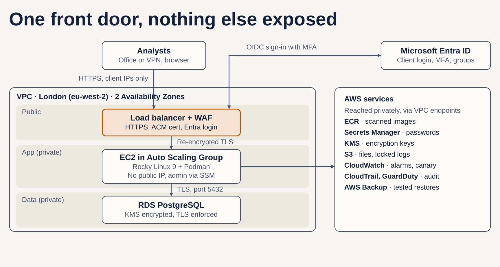

# Secure analytics dashboard on AWS

A small team of analysts needs an internal dashboard on sensitive, regulated data (think pharma or clinical trials). This repo is my design for hosting it on AWS, and a working build of its core in Terraform, with a containerised Shiny for Python app.

All data is synthetic. Nothing here touches real patient or company data.


## The design in one picture



**The idea:** one front door. The only thing on the internet is a load balancer, and it only answers the client's IP ranges. Nobody reaches the app without signing in through Microsoft Entra ID with MFA. The server and data sit in private subnets, everything is encrypted, and every action is logged somewhere the server can't delete.

The picture is the full target design. The demo builds the core of it (see *What the build includes*).

## What the build includes

| Area | What's built | Where |
| --- | --- | --- |
| Network | VPC across 2 AZs; public subnets for the load balancer and NAT only; private app subnets; S3 gateway endpoint | `terraform/network.tf` |
| Front door | Application Load Balancer, HTTPS only (TLS 1.2+), HTTP redirects to HTTPS, security group limited to allowed IPs, invalid headers dropped | `terraform/alb.tf` |
| Login | ALB `authenticate-oidc` against Entra ID; 1-hour sessions; only assigned users can sign in | `terraform/alb.tf` |
| Server | Rocky Linux 9 in an Auto Scaling Group (self-healing); no public IP; no SSH, admin via SSM Session Manager; IMDSv2 with hop limit 1; encrypted disk | `terraform/compute.tf` |
| App | Shiny for Python in a container: non-root, read-only filesystem, no Linux capabilities, run by Podman under systemd | `app/` |
| Identity check | The app verifies the load balancer's signed JWT (ES256, signer = this ALB) over the exact signed text, and refuses any session it can't attribute to a person | `app/identity.py` |
| Secrets | Entra client secret in Secrets Manager, encrypted with a customer-managed KMS key; never in code | `terraform/security.tf` |
| Images | ECR with scan on push and immutable tags | `terraform/compute.tf` |
| Audit trail | App audit events (who, what, when) shipped to CloudWatch Logs, so they survive the server being replaced | `terraform/monitoring.tf` |
| Monitoring | Alarms to email: no healthy server, app 5xx, slow responses, high CPU; memory and disk via CloudWatch agent; VPC Flow Logs; ALB access logs | `terraform/monitoring.tf` |

**Design only, not in the demo:** RDS PostgreSQL (Multi-AZ), AWS WAF, TLS between the load balancer and the server, a domain with an ACM-issued certificate (the demo uses self-signed), a NAT gateway per AZ, CloudTrail with S3 Object Lock, AWS Backup, remote encrypted Terraform state. The reasons are in [docs/DESIGN.md](docs/DESIGN.md).

## How I tested it

- **App:** unit tests prove that a valid load-balancer token is accepted, and that forged, expired, wrongly-signed or missing tokens are rejected. Run locally in a browser; a forged identity header sent over the websocket was refused and logged as `access_denied`.
- **CI:** every push runs the tests, builds the container, and runs `terraform fmt` and `terraform validate`.
- **Live on AWS:** deployed on 9 October 2026, then broken on purpose. A real bug showed up in my own token check and is fixed in v2, with a test that fails on v1. See [docs/BUILD-LOG.md](docs/BUILD-LOG.md) for what happened, including what went wrong and how I fixed it. Screenshots are in [docs/evidence](docs/evidence/README.md).

## What I found by running it

- **Token check bug (fixed in v2).** The load balancer signs its identity token with base64 padding. v1 stripped the padding before verifying, so the signature failed for users whose token needed padding, and their dashboard sat on loading spinners. v2 verifies the exact signed text. `app/tests/test_identity.py` signs tokens the way the real load balancer does and fails on v1.
- **Logs went to /dev/null.** Podman's `passthrough` log driver under systemd meant no audit events reached CloudWatch. v2 writes them to a file the agent ships.
- **Recovery times, one server:** container killed, restarted in about 22 s; service stopped, unhealthy after 48 s, replacement launched after 85 s, healthy again in about 5 minutes with no human action.
- **Known issue:** each audit line appears twice in CloudWatch (two writers to one file). Harmless; the fix is `StandardOutput=journal` in the unit.

## Deploy it yourself

About 3 hours and £1-2 if you destroy it the same day. Step by step: [docs/DEPLOY.md](docs/DEPLOY.md).

## Repo layout

```
app/                Shiny dashboard, identity check, Dockerfile, unit tests
terraform/          All infrastructure as code
docs/DESIGN.md      Assumptions, decisions and trade-offs, compliance mapping
docs/DEPLOY.md      Deploy, test, break, destroy
docs/BUILD-LOG.md   What actually happened when I built it
docs/evidence/      Screenshots from the live build
```

## What I'd do next

1. Move Terraform state to an encrypted S3 backend with locking (local state holds the client secret).
2. Add RDS PostgreSQL in private data subnets, with the password rotated by Secrets Manager.
3. AWS WAF on the load balancer, with the cookie-size rule tuned for the login cookies.
4. Deploy the app through CI to a test environment first, then promote the same image to production.
5. Two servers across two AZs, and a NAT gateway per AZ.
